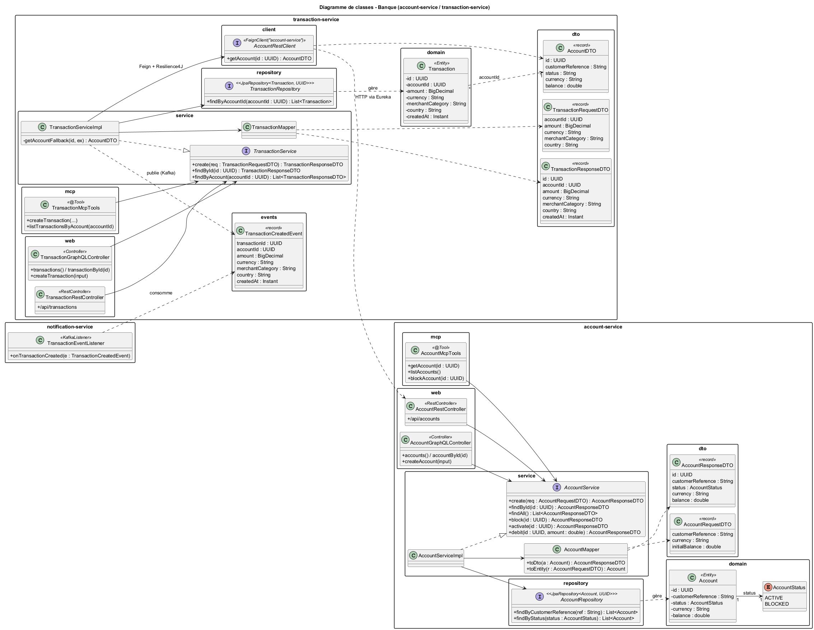

# Architecture du projet

## Architecture micro-services


Source : [architecture.puml](architecture.puml)

## Diagramme de classes



Source : [class-diagram.puml](class-diagram.puml)

## Composants

### Clients
- **Client Angular** : interface web qui consomme les API REST / GraphQL exposées par la gateway.
- **Client REST / Bot Telegram** : accès programmatique aux API via la gateway, et dialogue en langage naturel avec l'agent IA.

### Infrastructure
- **gateway-service (8080)** : point d'entrée unique (Spring Cloud Gateway réactive) ; route les requêtes vers les services via Eureka (`lb://account-service`, `lb://transaction-service`).
- **discovery-service (8761)** : annuaire Eureka où chaque service s'enregistre, permettant la découverte et le load balancing.
- **config-service (8888)** : Spring Cloud Config Server ; centralise la configuration des services à partir du dossier `config-repo/`.

### Services métier
- **account-service (8081)** : gère les comptes (`Account`, statut `ACTIVE` / `BLOCKED`, solde, devise). Expose la même couche service via REST, GraphQL et des outils MCP.
- **transaction-service (8082)** : enregistre les transactions (`Transaction`). Vérifie le compte via OpenFeign protégé par un circuit breaker Resilience4J, puis publie un `TransactionCreatedEvent` dans Kafka. Expose aussi REST, GraphQL et MCP.
- **notification-service (8083)** : consomme le topic Kafka `bank.transactions.created` et déclenche les notifications.

### Messagerie
- **Kafka** : bus d'événements asynchrone ; le topic `bank.transactions.created` découple la création des transactions de leur traitement en aval.

### Intelligence artificielle
- **ai-agent-service (8084)** : agent Spring AI connecté à un LLM (OpenAI) ; il utilise un client MCP pour appeler les outils exposés par account-service et transaction-service.
- **LLM** : modèle de langage qui interprète les questions et décide des outils MCP à appeler (tool calling).

## Organisation des services métier

Chaque service métier suit la même structure de packages :

| Package | Rôle |
|---|---|
| `domain/` | entités JPA et enums |
| `repository/` | interfaces Spring Data JPA |
| `service/` | logique métier (interfaces + implémentations, mappers, DTOs) |
| `web/rest/` | contrôleurs REST |
| `web/graphql/` | contrôleurs GraphQL |
| `mcp/` | outils MCP (`@Tool`) pour l'agent IA |

Les contrôleurs REST, GraphQL et MCP appellent tous la même couche `service`.

## Régénérer les images

```bash
java -jar plantuml.jar -charset UTF-8 -tpng -o images docs/class-diagram.puml docs/architecture.puml
```
