<div class="title-page">

**École Normale Supérieure de l'Enseignement Technique de Mohammedia (ENSET)**
Université Hassan II de Casablanca

en partenariat avec **ADRIA Business & Technology**

<div class="big">Épreuve Technique de Sélection</div>

<div class="sub">Architecture micro-services, IA et développement full-stack</div>

Test ADRIA PFE 2027 — Épreuve pratique (durée : 3h)

**Réalisé par : Nawal EL AARAJ**

Cycle ingénieur — S5

Année scolaire : 2026/2027

Date : 30 octobre 2026

Repository : https://github.com/NAWAL-EL-AARAJ/el-aaraj-nawal-test-adria-pfe-27

</div>

<div class="page-break"></div>

## Sommaire

1. Introduction
2. Modules et ports
3. Partie A — Préparation
4. Partie B — Conception
5. Partie C — Account-Service, Transaction-Service, OpenFeign et Resilience4J
6. Partie D — Gateway, Eureka et Config Service
7. Partie E — Agent IA
8. Partie F — Kafka
9. Partie G — Client web Angular
10. Conclusion

<div class="page-break"></div>

## 1. Introduction

Ce travail a été réalisé dans le cadre de l'épreuve technique de sélection ADRIA pour le PFE 2027, une épreuve pratique de 3 heures.

**Besoin.** Une banque souhaite une plateforme qui permette de :

- gérer des **comptes bancaires** (création, consultation, blocage et activation, solde, devise) ;
- enregistrer des **transactions** (paiements et virements) en respectant des règles métier ;
- diffuser des **événements métier** à chaque transaction, pour découpler les traitements en aval ;
- proposer un **assistant conversationnel**, sur le web et sur Telegram, capable d'agir sur les comptes en langage naturel.

**Objectifs.** Concevoir une architecture micro-services découplée, résiliente et configurable de façon centralisée, exposer la même logique métier en REST, GraphQL et MCP, et brancher dessus un agent IA et un client web.

**Technologies.** Java 21, Maven multi-modules, Spring Boot 4.1.2, Spring Cloud 2025.1.4 (Gateway, Eureka, Config, OpenFeign), Resilience4J, Spring AI 2.0.1 (LLM via Groq, client et serveurs MCP), Spring for GraphQL, Apache Kafka, Angular 22 avec Angular Material, Docker Compose (Kafka et Kafka UI).

**Plan.** Après le tableau des modules, chaque partie de l'épreuve (A à G) est présentée : ce qui a été fait, les choix techniques, un extrait de code ou de configuration, et les captures.

## 2. Modules et ports

Les ports sont ceux définis dans les `application.properties` des modules et dans `config-repo/`.

| Module | Port | Rôle |
|---|---|---|
| discovery-service | 8761 | Annuaire Eureka |
| config-service | 8888 | Spring Cloud Config Server (profil `native`, dossier `config-repo/`) |
| gateway-service | 8080 | Point d'entrée unique (Spring Cloud Gateway), CORS pour `http://localhost:4200` |
| account-service | 8081 | Comptes : REST, GraphQL et MCP, base H2 |
| transaction-service | 8082 | Transactions : REST, GraphQL et MCP, Feign et Resilience4J, producteur Kafka |
| notification-service | 8083 | Consommateur Kafka |
| ai-agent-service | 8084 | Agent Spring AI (`/api/chat`) et bot Telegram |
| Kafka | 9092 | Broker (mode KRaft, `docker-compose-infra.yml`) |
| Kafka UI | 8090 | Interface web de Kafka |
| frontend (Angular) | 4200 | Client web (`ng serve`) |

> Remarque : au moment des captures, le port 8080 était déjà occupé sur le poste par un autre logiciel (Jenkins), et le port 4200 par un autre projet. La gateway a donc été lancée sur **8086** et le front sur **4201**, avec la même configuration. Les ports du projet restent 8080 et 4200.

<div class="page-break"></div>

## 3. Partie A — Préparation

**Ce qui a été fait.**

- Création du dépôt GitHub `el-aaraj-nawal-test-adria-pfe-27`.
- Mise en place d'un projet **Maven multi-modules** : un `pom.xml` parent (packaging `pom`) qui déclare les 7 modules et centralise les versions par des BOM (Spring Cloud, Spring AI).
- Commits réguliers et courts, un par étape : création des modules, gateway, account service, transaction service, Feign et Resilience4J, Kafka, etc.

**Extrait (pom.xml parent) :**

```xml
<parent>
    <groupId>org.springframework.boot</groupId>
    <artifactId>spring-boot-starter-parent</artifactId>
    <version>4.1.2</version>
</parent>
<properties>
    <java.version>21</java.version>
    <spring-ai.version>2.0.1</spring-ai.version>
    <spring-cloud.version>2025.1.4</spring-cloud.version>
</properties>
```

**Choix technique.** Les versions de Spring Boot, Spring Cloud et Spring AI ont été choisies compatibles entre elles et gérées une seule fois dans le parent. Les modules n'indiquent donc aucune version.

## 4. Partie B — Conception

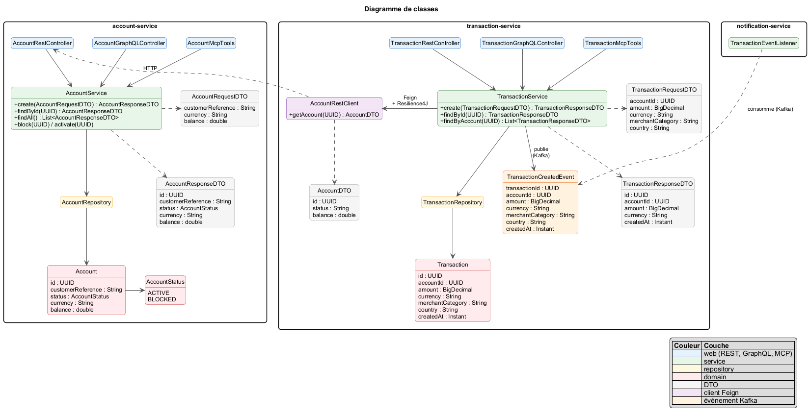

*Figure B1 — Diagramme de classes.* Un `Account` (identifiant UUID, référence client, statut `ACTIVE` ou `BLOCKED`, devise, solde) possède des `Transaction` (montant, devise, catégorie marchand, pays, type `DEBIT`, `CREDIT` ou `TRANSFER`). Comme les deux entités sont dans des services différents, le lien se fait par `accountId` et non par une clé étrangère.

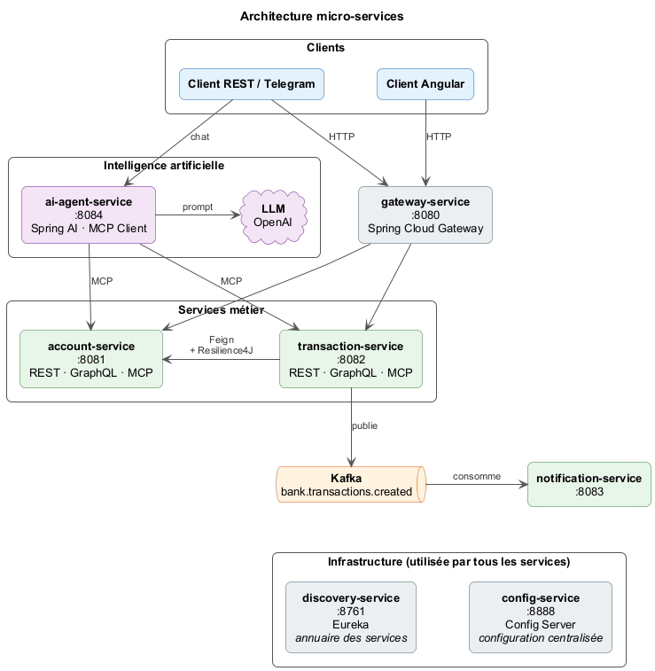

*Figure B2 — Architecture micro-services.* Les clients (Angular, REST, Telegram) passent par la gateway. Les services s'enregistrent dans Eureka et lisent leur configuration dans config-service. transaction-service appelle account-service via OpenFeign et publie dans Kafka. L'agent IA appelle les outils MCP des services métier.

<div class="page-break"></div>

## 5. Partie C — Account-Service, Transaction-Service, OpenFeign et Resilience4J

**Organisation en couches.** Chaque service métier suit la même structure :

| Package | Rôle |
|---|---|
| `domain/` | entités JPA et enums |
| `repository/` | interfaces Spring Data JPA |
| `service/` | logique métier, DTO, mappers, exceptions |
| `web/rest/` | contrôleurs REST et gestion globale des erreurs |
| `web/graphql/` | contrôleurs GraphQL |
| `mcp/` | outils MCP (`@Tool`) pour l'agent IA |

Les contrôleurs REST, GraphQL et MCP appellent **la même couche service**. Une règle métier n'est donc écrite qu'une seule fois.

**Règles métier (transaction-service) :**

- montant strictement positif ;
- montant au plus égal à `bank.transaction.max-amount` (1000, lu depuis config-service) ;
- compte existant et `ACTIVE` ;
- devise de la transaction identique à celle du compte ;
- solde suffisant ;
- virement uniquement entre deux comptes de même devise.

Une violation renvoie `422` avec un message explicite, un compte introuvable renvoie `404` et des données invalides renvoient `400`.

**OpenFeign et Resilience4J.** transaction-service lit et débite le compte via un client Feign (`lb://account-service`), protégé par un circuit breaker et un retry :

```properties
resilience4j.circuitbreaker.instances.accountService.sliding-window-size=10
resilience4j.circuitbreaker.instances.accountService.minimum-number-of-calls=5
resilience4j.circuitbreaker.instances.accountService.failure-rate-threshold=50
resilience4j.circuitbreaker.instances.accountService.wait-duration-in-open-state=10s
resilience4j.retry.instances.accountService.max-attempts=3
```

Les erreurs métier (compte introuvable, opération refusée) sont **ignorées** par le circuit breaker : seule une vraie indisponibilité ouvre le circuit. Le fallback renvoie `503 - Service compte indisponible, réessayez plus tard`.

**MCP.** Les services exposent leurs outils MCP en `STREAMABLE` HTTP sur `/mcp`, par exemple :

```java
@Tool(description = "Retourne le solde et la devise d'un compte bancaire")
public String getBalance(@ToolParam(description = "Identifiant UUID du compte") String accountId) {
    AccountResponseDTO account = accountService.findById(UUID.fromString(accountId));
    return String.format(Locale.ROOT, "%.2f %s", account.balance(), account.currency());
}
```

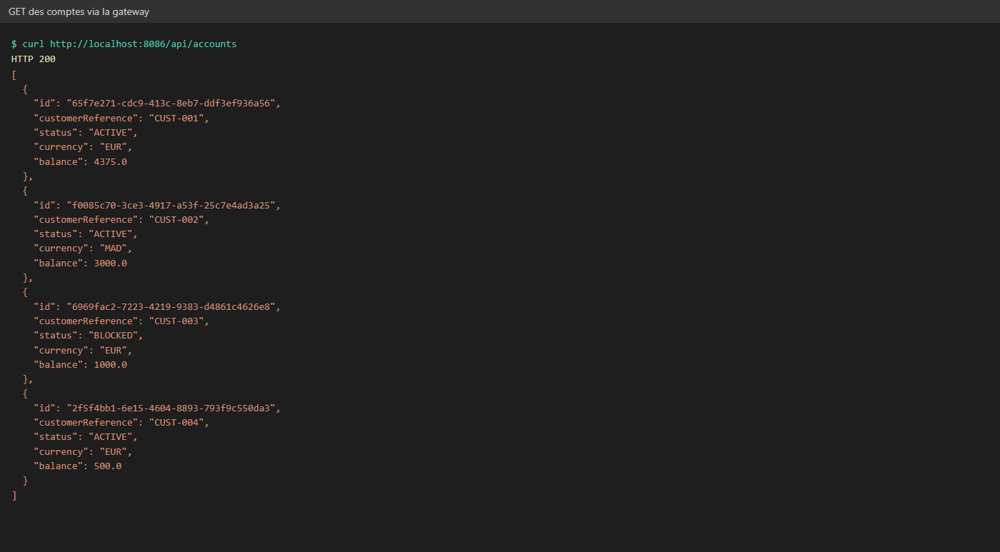

*Figure C1 — Liste des comptes via la gateway.* Les 3 comptes créés au démarrage : un compte EUR actif, un compte MAD actif et un compte EUR bloqué. La gateway route `/api/accounts/**` vers `lb://ACCOUNT-SERVICE`.

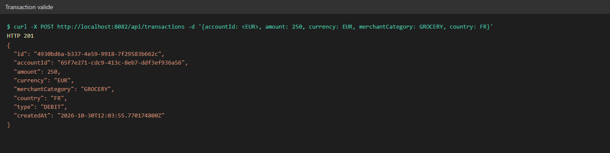

*Figure C2 — Transaction valide.* Réponse `201` avec une transaction `DEBIT`. Le solde du compte est débité dans account-service via Feign.

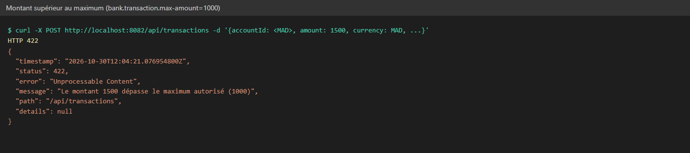

*Figure C3 — Montant supérieur au maximum.* Un paiement de 1500 est refusé en `422`, car la limite de 1000 vient de la configuration centralisée.

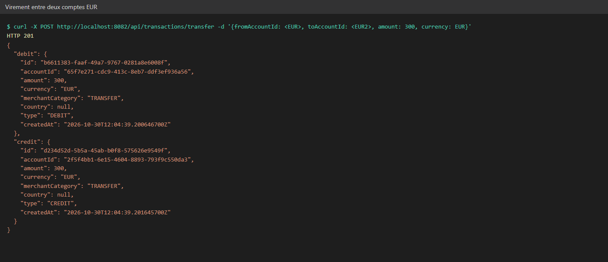

*Figure C4 — Virement entre deux comptes EUR.* Deux transactions `TRANSFER` sont créées : un débit sur le compte source et un crédit sur le compte destination.

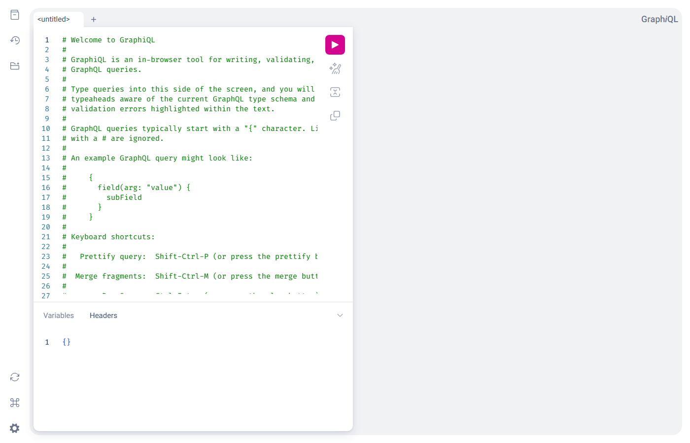

*Figure C6 — GraphiQL d'account-service.* La même couche service est exposée en GraphQL (`/graphql`, et `/graphql/accounts` via la gateway).

Le scénario de fallback Resilience4J (account-service arrêté, puis circuit `OPEN`) est décrit pas à pas dans `docs/tests.md`, section 10. Faute de temps, il n'a pas été capturé.

<div class="page-break"></div>

## 6. Partie D — Gateway, Eureka et Config Service

- **Eureka (8761)** : chaque service s'enregistre, et la gateway et Feign résolvent les adresses par nom (`lb://...`).
- **Config Service (8888)** : profil `native`, il lit le dossier `config-repo/`. Le maximum autorisé y est défini dans `application.properties` :

```properties
bank.transaction.max-amount=1000
```

La valeur peut être rechargée à chaud avec `POST /actuator/refresh` sur transaction-service.

- **Gateway (8080)** : routes explicites `/api/accounts/**`, `/api/transactions/**`, `/api/chat/**`, `/graphql/accounts` et `/graphql/transactions`, plus un CORS global pour le client Angular.

```java
.route("account-service", r -> r.path("/api/accounts/**").uri("lb://ACCOUNT-SERVICE"))
.route("transaction-service", r -> r.path("/api/transactions/**").uri("lb://TRANSACTION-SERVICE"))
.route("ai-agent-service", r -> r.path("/api/chat/**").uri("lb://AI-AGENT-SERVICE"))
```

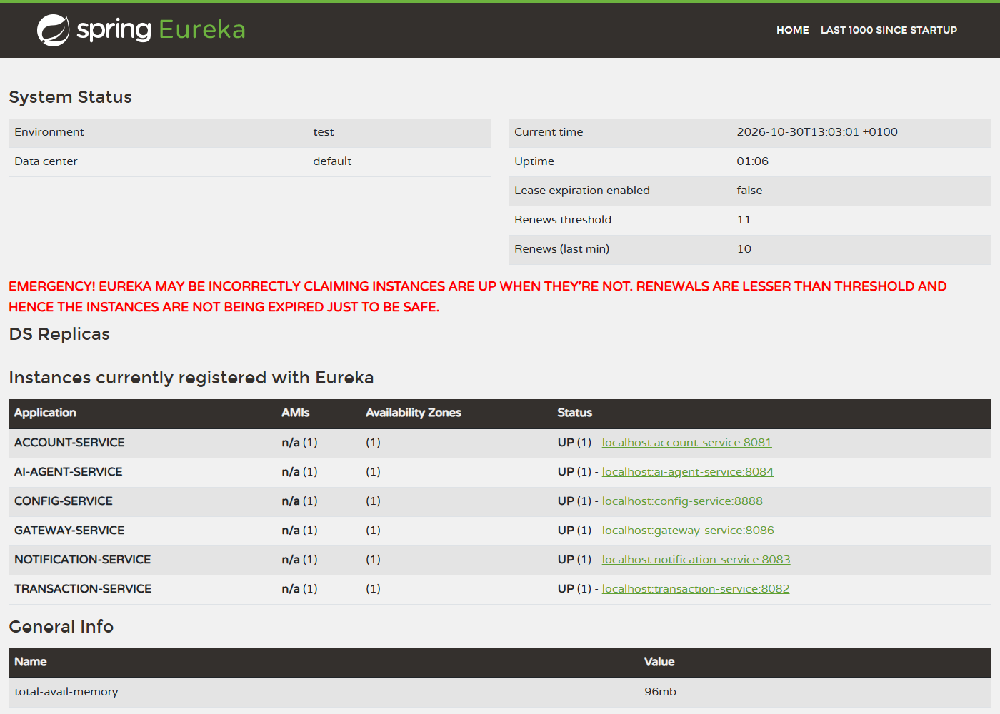

*Figure D1 — Tableau de bord Eureka.* Les services enregistrés auprès de l'annuaire.

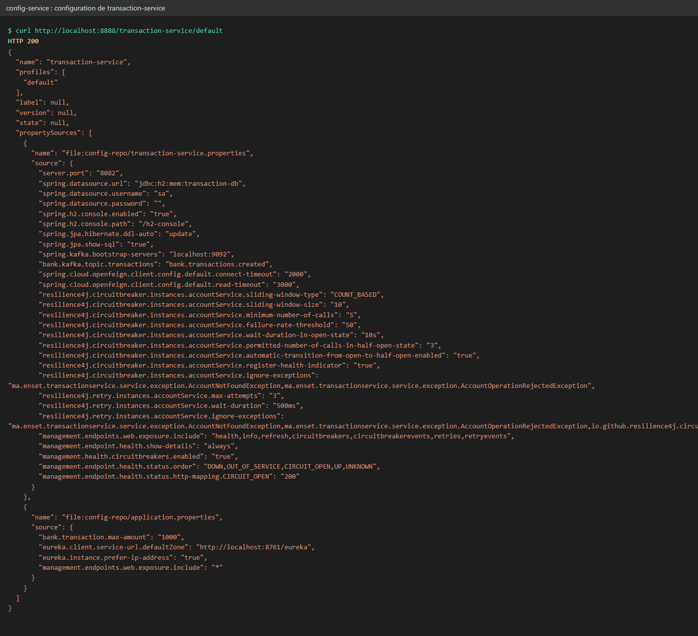

*Figure D2 — Configuration servie à transaction-service.* `bank.transaction.max-amount=1000` vient de `config-repo/application.properties`, avec les réglages Feign, Resilience4J et Kafka de `config-repo/transaction-service.properties`.

<div class="page-break"></div>

## 7. Partie E — Agent IA

**Ce qui a été fait.** `ai-agent-service` (8084) est un agent **Spring AI** :

- **LLM** : API compatible OpenAI fournie par **Groq** (clé lue dans la variable `GROQ_API_KEY`, modèle modifiable par `LLM_MODEL`) ;
- **client MCP** : il se connecte aux serveurs MCP d'account-service (8081) et de transaction-service (8082), et les outils (lister les comptes, solde, créer ou bloquer un compte, paiement, historique, virement) sont donnés au LLM, qui décide lui-même lesquels appeler ;
- **mémoire de conversation** : `MessageChatMemoryAdvisor`, isolée par `conversationId` ;
- **API REST** : `POST /api/chat` avec `{conversationId, message}` renvoie `{conversationId, answer}`, et une erreur du LLM ou d'un service renvoie un `503` clair ;
- **bot Telegram** : long polling (`getUpdates`, sans webhook, donc il fonctionne en local), activé seulement si `TELEGRAM_BOT_TOKEN` est défini. Chaque message passe par le même `AgentService` que `/api/chat`, avec le chatId Telegram comme conversationId. `/start` affiche un message d'accueil, une erreur déclenche un message clair, et les réponses de plus de 4000 caractères sont découpées en plusieurs messages.

```java
@Bean
public ChatClient chatClient(ChatClient.Builder builder, ChatMemory chatMemory, ToolCallbackProvider mcpTools) {
    return builder
            .defaultSystem(SYSTEM_PROMPT)
            .defaultAdvisors(MessageChatMemoryAdvisor.builder(chatMemory).build())
            .defaultToolCallbacks(mcpTools)
            .build();
}
```

```properties
spring.ai.mcp.client.streamable-http.connections.account-service.url=http://localhost:8081
spring.ai.mcp.client.streamable-http.connections.transaction-service.url=http://localhost:8082
telegram.bot.token=${TELEGRAM_BOT_TOKEN:}
```

Au démarrage, le log confirme la connexion du bot :
`Bot Telegram connecté : @adria_nawal_bank_bot (id 8801613049), mode long polling`.

**Point en cours.** Avec le modèle `openai/gpt-oss-120b` de Groq, l'enchaînement « appel d'outil puis réponse » est refusé par Groq (champ `reasoning_content` non accepté). L'agent répond alors par le message d'erreur prévu. La correction identifiée consiste à ajouter l'option `spring.ai.openai.chat.options.extra-body.include_reasoning=false`.

Capture Telegram : captures/e-telegram.png

<div class="page-break"></div>

## 8. Partie F — Kafka

- Topic **`bank.transactions.created`** (3 partitions), créé par transaction-service.
- Clé du message : **`accountId`**. Tous les événements d'un même compte vont dans la même partition, donc dans l'ordre.
- Publication **après le commit** (`@TransactionalEventListener(AFTER_COMMIT)`) : une transaction refusée ou annulée ne produit aucun événement.
- **notification-service** (groupe `notification-group`) consomme le topic et journalise une notification. Un message illisible est ignoré grâce à `ErrorHandlingDeserializer`.

Format de l'événement :

```json
{"eventId":"...","eventType":"TransactionCreated","transactionId":"...",
 "accountId":"<id du compte>","amount":75,"currency":"EUR",
 "occurredAt":"2026-10-30T11:11:08.282885800Z"}
```

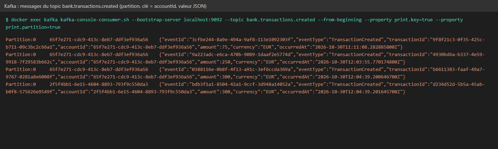

*Figure F1 — Messages du topic `bank.transactions.created`.* Chaque ligne affiche la partition, la clé (`accountId`) et l'événement JSON publié par transaction-service.

<div class="page-break"></div>

## 9. Partie G — Client web Angular

**Ce qui a été fait.** Une application Angular 22 (`frontend/`), avec Angular Material et des composants standalone :

- `ApiService` : tous les appels passent par la gateway ;
- page **Comptes** : tableau (client, id, statut, devise, solde), formulaire de création, boutons Bloquer et Activer ;
- page **Transactions** : liste, formulaire de nouvelle transaction, formulaire de virement, et erreurs du backend affichées dans une snackbar ;
- page **Assistant** : chat qui appelle `POST /api/chat` avec un `conversationId` propre à la session ;
- barre de navigation entre les 3 pages.

```typescript
createTransaction(request: TransactionRequest): Observable<Transaction> {
  return this.http.post<Transaction>(`${this.baseUrl}/transactions`, request);
}
```

`npx ng build` passe sans erreur.

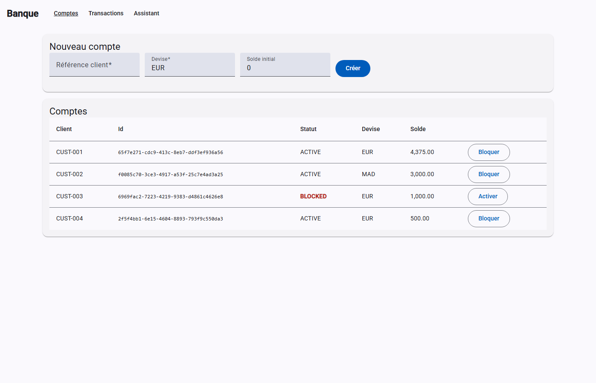

*Figure G1 — Page Comptes.* Tableau des comptes, avec le statut BLOCKED en rouge, le formulaire de création et les boutons Bloquer et Activer, qui appellent `PUT /api/accounts/{id}/block` et `/activate`.

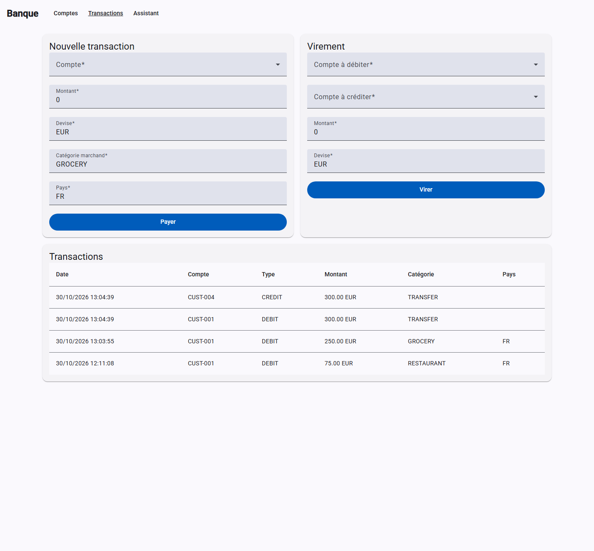

*Figure G2 — Page Transactions.* Formulaires de paiement et de virement, et historique des transactions. Les erreurs `4xx` et `5xx` du backend s'affichent dans une snackbar.

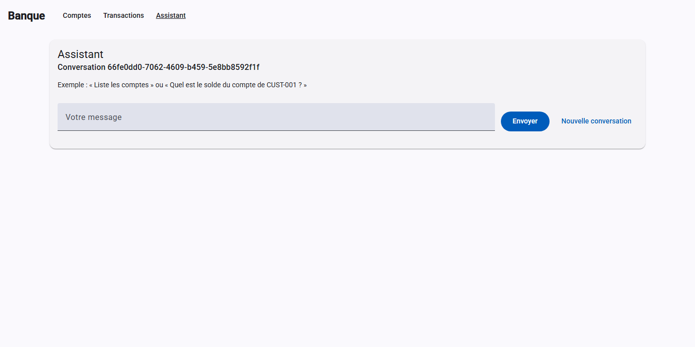

*Figure G3 — Page Assistant.* Chat relié à `POST /api/chat`, avec un `conversationId` par session et un bouton « Nouvelle conversation ».

<div class="page-break"></div>

## 10. Conclusion

**Bilan.**

- **A** : dépôt et projet Maven multi-modules en place.
- **B** : diagramme de classes et architecture.
- **C** : deux services métier en couches, exposés en REST, GraphQL et MCP, avec règles métier, Feign et Resilience4J.
- **D** : gateway, Eureka et configuration centralisée.
- **E** : agent Spring AI avec client MCP, mémoire de conversation et bot Telegram.
- **F** : événements Kafka avec producteur et consommateur.
- **G** : client Angular avec trois pages.

**Compétences mobilisées.** Architecture micro-services Spring Cloud, conception en couches, résilience (circuit breaker, retry, fallback), messagerie événementielle, intégration d'un LLM et du protocole MCP, développement front Angular.

**Difficultés.**

- Le temps limité de 3 heures a imposé de prioriser.
- Le démarrage de Kafka (Docker, listeners interne et externe) a demandé de la configuration.
- L'intégration du LLM et du MCP a posé des problèmes de compatibilité entre le fournisseur (Groq) et Spring AI.
- Sur le poste, des ports étaient déjà occupés par d'autres logiciels.

**Perspectives.**

- Sécurisation avec **Keycloak** (OAuth2 et JWT sur la gateway).
- Partie **H** : service de détection de fraude en Python, consommateur des événements Kafka.
- Partie **I** : conteneurisation Docker de tous les services et pipeline CI/CD.
- Tests d'intégration (Testcontainers pour Kafka, tests des contrôleurs et du circuit breaker).
